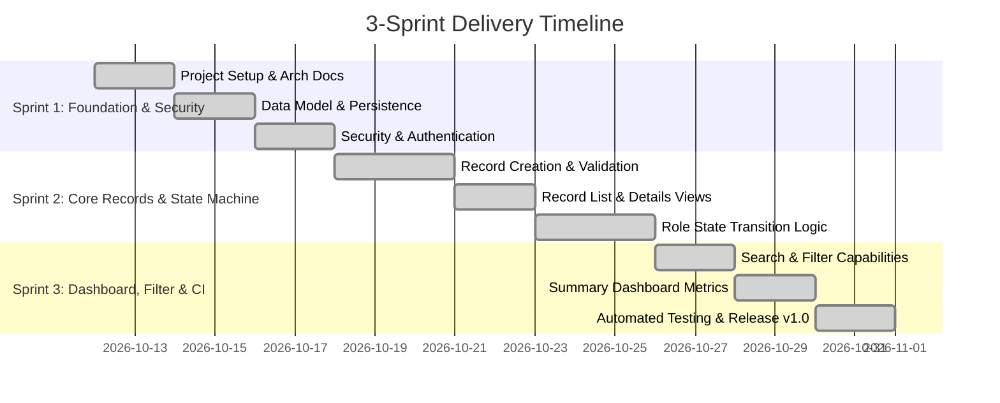

# 02 - Agile Planning & Product Backlog

**Project:** Telecom Tower Maintenance Portal  
**Methodology:** Agile Scrum + Kanban  
**Release Target:** MVP v1.0.0  

---

## 1. User Stories & Acceptance Criteria

### US-01: User Authentication & Role-Based Access
**As a** registered telecom staff member (Technician, Supervisor, Administrator),  
**I want to** authenticate securely with my username and password,  
**So that** I access only the maintenance actions authorized for my role.

*Acceptance Criteria:*
- **Given** I am an unauthenticated user navigating to any application page,  
  **When** I access the site,  
  **Then** I am redirected to `/login` with an intuitive login form.
- **Given** I enter valid credentials (`tech1/tech123`, `sup1/sup123`, or `admin/admin123`),  
  **When** I submit the form,  
  **Then** I am authenticated and redirected to the dashboard or records list with role-tailored actions displayed.
- **Given** I enter invalid credentials,  
  **When** I submit the form,  
  **Then** I receive an error alert message stating invalid credentials, and access is refused.

---

### US-02: Maintenance Record Creation
**As a** Field Technician,  
**I want to** create a new maintenance record with tower ID, location, issue type, description, and priority,  
**So that** the operational problem is registered and queued for remediation.

*Acceptance Criteria:*
- **Given** I am logged in as a TECHNICIAN or ADMIN,  
  **When** I navigate to `/records/new`,  
  **Then** a creation form is presented with fields: `towerId`, `location`, `issueType`, `description`, `priority`, and `assignedTechnician`.
- **Given** I fill all required fields with valid input and select priority (`LOW`, `MEDIUM`, `HIGH`, `CRITICAL`),  
  **When** I submit the form,  
  **Then** the record is persisted with status `OPEN`, created timestamp, and `createdBy` populated with my username.
- **Given** any required field is left blank,  
  **When** I submit the form,  
  **Then** the form is re-rendered highlighting validation errors without losing existing entered values.

---

### US-03: Maintenance Record Listing & Overview
**As a** telecom staff member,  
**I want to** view a tabular list of all tower maintenance records,  
**So that** I have immediate visibility of current tower conditions.

*Acceptance Criteria:*
- **Given** I am logged in with any valid role,  
  **When** I navigate to `/records`,  
  **Then** I see a responsive table displaying Tower ID, Location, Issue Type, Priority badge, Assigned Technician, Status badge, and Created Date.
- **Given** records exist in the system,  
  **When** the table renders,  
  **Then** each record row includes a clickable "View" action button linking to `/records/{id}`.

---

### US-04: Record Detail & Inspection View
**As a** Supervisor or Technician,  
**I want to** inspect the full details of a specific maintenance ticket,  
**So that** I can assess diagnosis notes, historical timestamps, and technical details before acting.

*Acceptance Criteria:*
- **Given** an existing maintenance record ID,  
  **When** I navigate to `/records/{id}`,  
  **Then** all ticket details (including ID, timestamps, description, and assigned technician) are displayed clearly.
- **Given** a non-existent record ID,  
  **When** I attempt to open the details page,  
  **Then** an appropriate error message is displayed and the user is redirected gracefully.

---

### US-05: Technician Progress Execution
**As a** Field Technician,  
**I want to** transition an `OPEN` ticket to `IN_PROGRESS` and subsequently to `COMPLETED`,  
**So that** dispatch progress and job completion are communicated in real time.

*Acceptance Criteria:*
- **Given** a record has status `OPEN` and I am a TECHNICIAN or ADMIN,  
  **When** I click "Start Work",  
  **Then** the record status updates to `IN_PROGRESS`.
- **Given** a record has status `IN_PROGRESS` and I am a TECHNICIAN or ADMIN,  
  **When** I click "Mark Completed",  
  **Then** the record status transitions to `COMPLETED`.
- **Given** a record is in any other status,  
  **When** a technician attempts an unauthorized transition,  
  **Then** the transition is blocked and an error message is returned.

---

### US-06: Supervisor Verification & Rejection Workflow
**As a** Maintenance Supervisor,  
**I want to** verify or reject records marked as `COMPLETED`,  
**So that** high technical standards are maintained before sign-off.

*Acceptance Criteria:*
- **Given** a record is in status `COMPLETED` and I am logged in as SUPERVISOR or ADMIN,  
  **When** I inspect the record,  
  **Then** "Approve & Verify" and "Reject Work" buttons are available.
- **Given** I click "Approve & Verify",  
  **When** the action is processed,  
  **Then** the record status advances to `VERIFIED`.
- **Given** I click "Reject Work",  
  **When** the action is processed,  
  **Then** the record status reverts to `IN_PROGRESS` with an audit notice.

---

### US-07: Admin Final Closure & Oversight
**As a** System Administrator,  
**I want to** close `VERIFIED` records and maintain global administrative control,  
**So that** audited tower jobs are archived into a closed state.

*Acceptance Criteria:*
- **Given** a record is in status `VERIFIED` and I am logged in as ADMIN,  
  **When** I click "Close Record",  
  **Then** the record status changes to `CLOSED`.
- **Given** I am an ADMIN,  
  **When** viewing any record,  
  **Then** I have administrative edit and workflow override privileges.

---

### US-08: Executive Summary Dashboard & Search Filtering
**As an** Operations Lead or Manager,  
**I want to** view aggregated status/priority metrics and filter records by tower, location, or status,  
**So that** operational health can be evaluated at a glance and specific issues located instantly.

*Acceptance Criteria:*
- **Given** I navigate to `/dashboard`,  
  **When** the page loads,  
  **Then** summary cards display: Total Records, Open/In-Progress (Pending), Completed/Verified, Closed, and breakdown counters by Priority.
- **Given** I am on the record listing view,  
  **When** I enter a search keyword (Tower ID or Location) or filter by Status or Priority,  
  **Then** the table updates dynamically to display only matching records.

---

## 2. Product Backlog Table

| Backlog ID | User Story Title | Priority | Story Points | Sprint | Status | Target Task Mapping |
|---|---|---|:---:|:---:|:---:|---|
| **PB-01** | User Authentication & Role Security | High | 5 | Sprint 1 | **DONE** | TASK-07, TASK-08 |
| **PB-02** | Maintenance Record Domain & DB Persistence | High | 5 | Sprint 1 | **DONE** | TASK-05, TASK-06 |
| **PB-03** | Record Creation Form with Validation | High | 3 | Sprint 2 | **DONE** | TASK-09 |
| **PB-04** | Record Listing Table View | High | 3 | Sprint 2 | **DONE** | TASK-10 |
| **PB-05** | Record Detail Inspection View | Medium | 2 | Sprint 2 | **DONE** | TASK-11 |
| **PB-06** | Role-Based State Transition Workflow Engine | High | 8 | Sprint 2 | **DONE** | TASK-12 |
| **PB-07** | Search & Filter Capabilities | Medium | 5 | Sprint 3 | **DONE** | TASK-10 |
| **PB-08** | Executive KPI Summary Dashboard | Medium | 5 | Sprint 3 | **DONE** | TASK-13, TASK-14 |
| **PB-09** | Selenium E2E Automated Test Suite | High | 8 | Sprint 3 | **DONE** | TASK-15 |
| **PB-10** | Continuous Testing in Jenkins CI Pipeline | High | 5 | Sprint 3 | **DONE** | TASK-16 |

---

## 3. 14-Task Kanban Board (MVP v1.0.0 Finalized)

| Backlog | To Do | In Progress | Review | Done (Completed & Verified) |
|---|---|---|---|---|
| - | - | - | - | **TASK-01** (Problem Def & Scope) |
| - | - | - | - | **TASK-02** (Agile Backlog & Kanban) |
| - | - | - | - | **TASK-03** (Architecture & Skeleton) |
| - | - | - | - | **TASK-04** (Git/GitHub & Issues) |
| - | - | - | - | **TASK-05** (JPA Entity & Repository) |
| - | - | - | - | **TASK-06** (Service Layer & Rules) |
| - | - | - | - | **TASK-07** (Security Config & RBAC) |
| - | - | - | - | **TASK-08** (Layout & Login Views) |
| - | - | - | - | **TASK-09** (Record Create Form) |
| - | - | - | - | **TASK-10** (Record List & Filter) |
| - | - | - | - | **TASK-11** (Record Detail View) |
| - | - | - | - | **TASK-12** (State Transition Engine) |
| - | - | - | - | **TASK-13** (Executive KPI Dashboard) |
| - | - | - | - | **TASK-14** (Test Suite & Tag v1.0.0) |
| - | - | - | - | **TASK-15** (Selenium E2E Test Suite — Task 9) ✅ |
| - | - | - | - | **TASK-16** (Continuous Testing in Jenkins — Task 10) ✅ |

---

## 4. 3-Sprint Plan

### Sprint Breakdown
- **Sprint 1: Architecture, Data & Security Foundation (Tasks 1–7)** &mdash; Completed
- **Sprint 2: Record Operations & State Transition Workflow (Tasks 8–12)** &mdash; Completed
- **Sprint 3: Dashboard, Filtering, Automation & Release (Tasks 13–16)** &mdash; Completed ✅ *(Includes Task 9: Selenium E2E & Task 10: CI/CD Pipeline Gating)*

---

## 5. Definition of Done (DoD) Checklist

For any user story / task to be declared **DONE**, all criteria below must be met:
- [x] Code compiles cleanly with zero Maven warnings or errors.
- [x] All unit tests pass (`mvn clean test`).
- [x] Code strictly follows established branching policy (`feature/*` merged via pull request into `develop`).
- [x] All forms, inputs, and action buttons have stable HTML element `id` attributes for automated Selenium test scripts.
- [x] User-facing state transitions reject illegal role transitions with informative feedback.
- [x] Pull request created, reviewed, and cleanly merged without unhandled merge artifacts.
- [x] Task logged with execution evidence in `/docs/evidence-log.md`.

