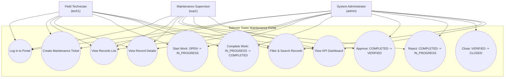
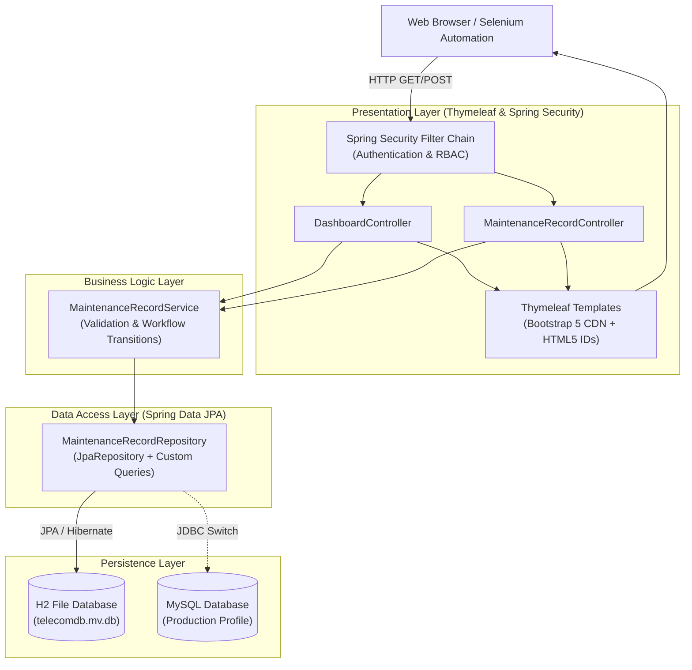
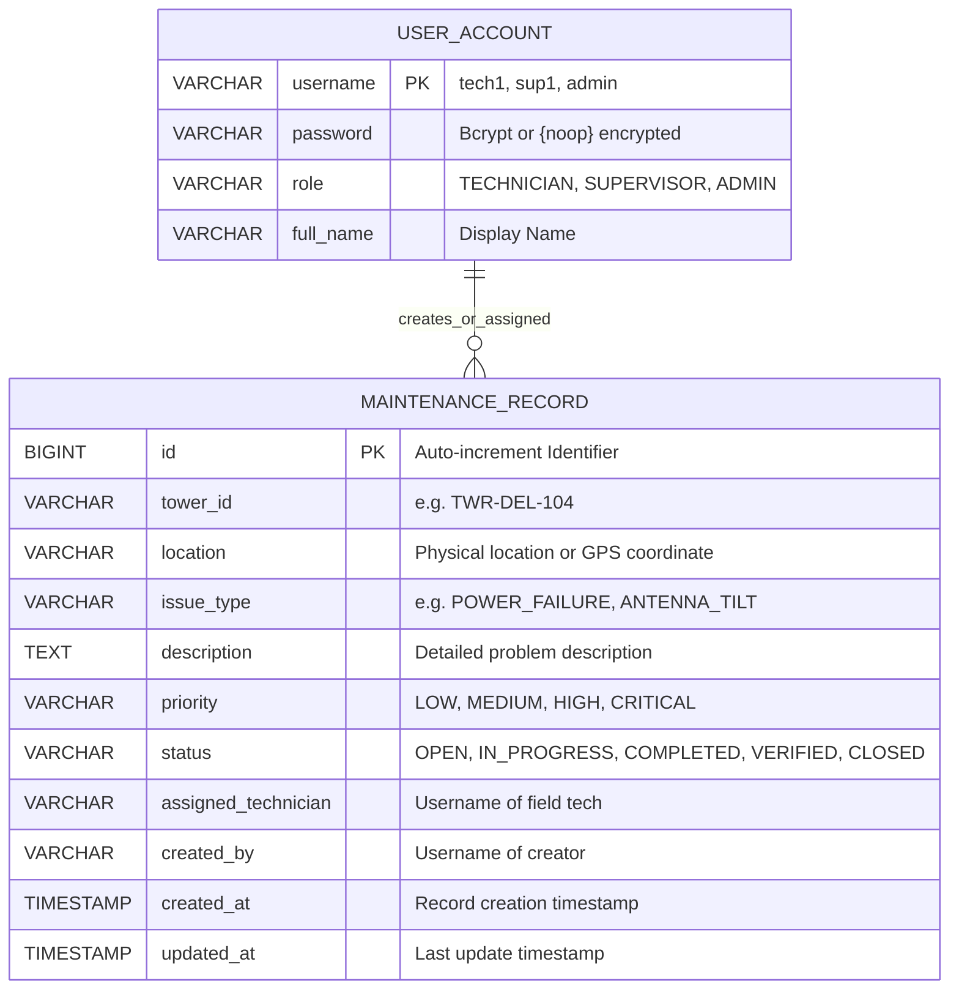

# 03 - System Architecture & Requirements Specification

**Project:** Telecom Tower Maintenance Portal  
**Document:** Software Requirements Specification (SRS) & Architectural Design  
**Target Platform:** Java 17 / Spring Boot 3 / Apache Tomcat  

---

## 1. Software Requirements Specification (SRS) Summary

### 1.1 Functional Requirements (FR)
- **FR-01 (Authentication & RBAC):** The system shall authenticate users and enforce role-based access control with roles `ROLE_TECHNICIAN`, `ROLE_SUPERVISOR`, and `ROLE_ADMIN`.
- **FR-02 (Record Creation):** Technicians and Admins shall be able to create maintenance records with attributes: `towerId`, `location`, `issueType`, `description`, `priority` (`LOW`, `MEDIUM`, `HIGH`, `CRITICAL`), and `assignedTechnician`.
- **FR-03 (State Machine Enforcement):**
  - Technicians can transition: `OPEN` $\to$ `IN_PROGRESS` $\to$ `COMPLETED`.
  - Supervisors can transition: `COMPLETED` $\to$ `VERIFIED`, or `COMPLETED` $\to$ `IN_PROGRESS` (rejection).
  - Admins can transition: `VERIFIED` $\to$ `CLOSED`, and perform administrative overrides across any state.
  - Any invalid transition attempt shall be rejected with an informative error message.
- **FR-04 (Record Search & Filter):** Users shall be able to filter maintenance tickets by Tower ID, Location, Status, and Priority.
- **FR-05 (Summary Dashboard):** The system shall compute and display live summary metrics including: total records, count by status, count by priority, and pending vs. completed/verified counts.
- **FR-06 (Health & Observability):** The system shall expose a `/actuator/health` endpoint reporting operational status.

### 1.2 Non-Functional Requirements (NFR)
- **NFR-01 (Security):** Passwords securely checked, CSRF protection enabled on web forms, and role-based endpoint restriction.
- **NFR-02 (Performance):** Dashboard page rendering shall take $< 2$ seconds under normal local load.
- **NFR-03 (Packaging & Portability):** Packaged as a standard deployable Web Application Archive (WAR), compatible with external Apache Tomcat and embedded Tomcat execution.
- **NFR-04 (Testability):** All interactive input fields, action buttons, and status indicators shall carry static and deterministic HTML `id` attributes to enable automated Selenium browser testing.
- **NFR-05 (Reliability & Persistence):** Maintenance records are persisted to an H2 file-based database (`./data/telecomdb`), with simple schema compatibility for MySQL production switchover via `application.properties`.

---

## 2. Mermaid Use-Case Diagram



---

## 3. Layered Architecture Diagram



---

## 4. Entity-Relationship (ER) Data Model



---

## 5. API & Web Endpoint Catalog

| Endpoint | HTTP Method | Authorized Roles | Description |
|---|:---:|---|---|
| `/login` | GET | PermitAll | Renders login page. |
| `/login` | POST | PermitAll | Processes authentication credentials. |
| `/logout` | GET/POST | Authenticated | Logs out current user and clears session. |
| `/` | GET | Authenticated | Redirects to `/dashboard`. |
| `/dashboard` | GET | Authenticated | Renders KPI summary cards and breakdown tables. |
| `/records` | GET | Authenticated | Displays records list with search filters. |
| `/records/new` | GET | TECHNICIAN, ADMIN | Displays ticket creation form. |
| `/records` | POST | TECHNICIAN, ADMIN | Validates and persists new maintenance record. |
| `/records/{id}` | GET | Authenticated | Displays detailed record view and transition controls. |
| `/records/{id}/edit` | GET | ADMIN | Displays edit form for all fields. |
| `/records/{id}/update`| POST | ADMIN | Persists full record updates. |
| `/records/{id}/transition` | POST | Authenticated | Executes role-validated status transition. |
| `/actuator/health` | GET | PermitAll | Spring Boot Actuator health check endpoint. |

---

## 6. Technology Choices & Justification

| Component | Choice | Justification |
|---|---|---|
| **Language & SDK** | Java 17 LTS | Modern LTS Java release offering performance, strong typing, record types, and long-term stability. |
| **Framework** | Spring Boot 3.2.x | Enterprise standard framework providing rapid configuration, Actuator health endpoints, and embedded/WAR deployment flexibility. |
| **View Engine** | Thymeleaf 3 | Server-side HTML5 template engine seamlessly integrated with Spring MVC, eliminating heavy frontend build steps while producing clean DOM elements for Selenium. |
| **Persistence** | Spring Data JPA + Hibernate | Simplifies CRUD operations, supports dynamic query methods, and facilitates zero-code query generation. |
| **Database** | H2 (File-based) | Zero-configuration local database that persists across restarts and allows instant portability, with straightforward configuration migration to MySQL for production. |
| **Security** | Spring Security 6 | Industry-standard security architecture providing declarative role checks, password hashing, and CSRF protection. |
| **UI Styling** | Bootstrap 5.3 (CDN) | Lightweight, responsive, professional layout requiring no npm toolchains. |
| **Packaging** | WAR (Maven Wrapper) | Meets the deployment requirement for Tomcat 10 containerization while remaining runnable via `mvn spring-boot:run`. |

---

## 7. Local Setup Instructions

### Prerequisites
- Java Development Kit (JDK) 17 or higher (`java -version`).
- Apache Maven 3.8+ or Maven Wrapper (`./mvnw`).
- Git 2.30+.

### Steps to Run
1. Clone the repository:
   ```bash
   git clone <REPO_URL>
   cd telecom-tower-maintenance-portal
   ```
2. Build and verify test suite:
   ```bash
   mvn clean test
   ```
3. Run the application locally:
   ```bash
   mvn spring-boot:run
   ```
4. Access the web application:
   - URL: `http://localhost:8081` (Port 8081 is chosen as Jenkins standardly occupies 8080)
   - Login credentials:
     - Technician: `tech1` / `tech123`
     - Supervisor: `sup1` / `sup123`
     - Administrator: `admin` / `admin123`
5. Verify health check:
   - URL: `http://localhost:8081/actuator/health`
