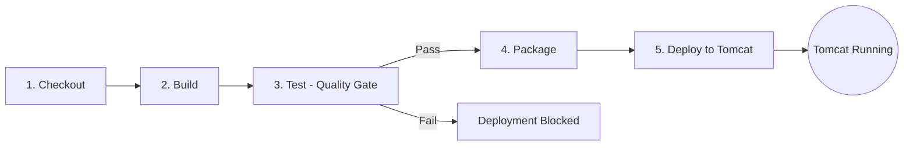

# Continuous Testing in Jenkins - Telecom Tower Maintenance Portal

## 1. Overview
This document details the Continuous Testing (CT) strategy and Jenkins CI/CD pipeline implementation for the **Telecom Tower Maintenance Portal** (Spring Boot 3, Maven WAR packaging, deployed to Apache Tomcat 10.1).

The pipeline enforces an automated Quality Gate where unit, service, controller, and Selenium end-to-end browser tests run automatically on every commit. If any test fails, deployment to Tomcat is strictly blocked.

---

## 2. Pipeline Configuration
The declarative pipeline is defined in [`Jenkinsfile`](file:///c:/Users/Vedanti/OneDrive/Desktop/devops%20project/Jenkinsfile) and runs on a local Windows agent with the following parameters and tools:
- **Pipeline Tools**:
  - `maven 'Maven3'`
  - `jdk 'JDK 21'`
- **Parameters**:
  - `ENVIRONMENT`: Choice parameter (`dev`, `test`), targeting specific Tomcat runtime contexts.
- **Environment Variables**:
  - `TOMCAT_HOME`: `C:\Program Files\apache-tomcat-10.1.61`

---

## 3. Stage-by-Stage Breakdown

### Stage 1: Checkout
- **Command**: `checkout scm`
- **Purpose**: Retrieves the latest revision from the configured Git branch (`develop`) into the Jenkins workspace.

### Stage 2: Build
- **Command**: `bat 'mvn clean compile'`
- **Purpose**: Cleans previous workspace artifacts and compiles all Java production sources (`src/main/java`) into `target/classes`. Validates syntax and dependency integrity.

### Stage 3: Test (Automated Quality Gate)
- **Command**: `bat 'mvn test'`
- **Execution Details**:
  - Runs all 21 automated tests:
    - Service layer unit tests (`MaintenanceRecordServiceTest`)
    - Controller & Spring MVC integration tests (`MaintenanceRecordControllerTest`)
    - Spring context initialization tests (`TelecomTowerApplicationTests`)
    - Selenium E2E web tests (`LoginSeleniumTest`, `CreateRecordSeleniumTest`, `SearchSeleniumTest`, `WorkflowDashboardSeleniumTest`)
  - Runs Chrome in headless mode (`--headless=new`) on a randomized ephemeral port (`webEnvironment = RANDOM_PORT`), avoiding port conflicts with Tomcat (port 8080).
- **Post Actions (`always`)**:
  - `junit 'target/surefire-reports/*.xml'`: Records test execution counts, durations, and pass/fail trends in the Jenkins Test Result UI.
  - `archiveArtifacts artifacts: 'target/screenshots/*.png', allowEmptyArchive: true`: Archives visual PNG screenshots captured by `ScreenshotOnFailureExtension` upon test failure.
- **Gating Rule**:
  - Does **not** use `catchError` or `ignoreFailures`. If any test fails, this stage aborts immediately with a non-zero exit code. Subsequent stages (**Package** and **Deploy**) are skipped.

### Stage 4: Package
- **Command**: `bat 'mvn package -DskipTests'`
- **Purpose**: Packages the application into an executable and deployable WAR bundle (`target/telecom-tower-maintenance-portal-1.0.0-SNAPSHOT.war`). Tests are skipped here since they already passed in Stage 3.
- **Archiving**: `archiveArtifacts artifacts: 'target/*.war', fingerprint: true` preserves the build artifact for traceability.

### Stage 5: Deploy
- **Command**: `bat 'copy /Y target\\*.war "%TOMCAT_HOME%\\webapps\\tower-portal-%ENVIRONMENT%.war"'`
- **Purpose**: Deploys the WAR file directly to the target Apache Tomcat instance under the context `tower-portal-%ENVIRONMENT%` (accessible at `http://localhost:8080/tower-portal-dev` or `test`). Tomcat automatically extracts the WAR and initializes Spring Boot.

### Post-Pipeline Actions
- **`success`**: Emits a confirmation log with the deployed URL.
- **`failure`**: Emits `'Pipeline failed - deployment blocked'` to notify developers that defective code was intercepted before reaching production or staging.
