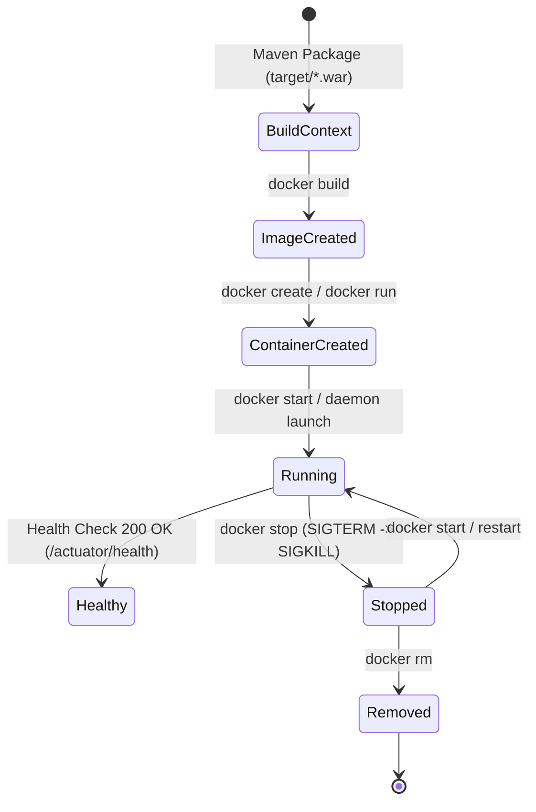

# 06 - Docker Containerization & Lifecycle Architecture

**Project:** Telecom Tower Maintenance Portal  
**Artifact:** Container Runtime & Lifecycle Guide  
**Base Image:** Eclipse Temurin 21 JRE (`eclipse-temurin:21-jre`)  
**Container Port:** `8080` | **Host Port:** `8084` (dev) / `8083` (test)

---

## 1. Fundamentals: Docker, Image, and Container

| Concept | Definition & Role | Analogy |
|---|---|---|
| **Docker** | An open-source container engine and runtime platform that automates the deployment of applications inside isolated lightweight environments using Linux kernel namespaces and cgroups. | The shipping port and cargo crane system. |
| **Docker Image** | A read-only, multi-layered immutable snapshot containing everything needed to run an application: OS rootfs, JRE binaries, application code (`app.war`), dependencies, configuration, and environment defaults. | The architectural blueprint or class definition. |
| **Docker Container** | A runnable, isolated instance of an image with an ephemeral writable layer (`Read-Write Layer`). Containers run natively on the host OS kernel with near-zero virtualization overhead. | An instantiated object or living house built from the blueprint. |

---

## 2. Dockerfile Explained Line-by-Line

```dockerfile
# 1. Base Image: Lightweight Eclipse Temurin OpenJDK 21 JRE
FROM eclipse-temurin:21-jre

# 2. Metadata Labels
LABEL maintainer="Telecom Tower Operations DevOps Team"
LABEL description="Telecom Tower Maintenance Portal Spring Boot WAR Container"

# 3. Environment Variables: Configurable runtime parameters
ENV JAVA_OPTS="-Xms256m -Xmx512m -XX:+UseG1GC" \
    SPRING_PROFILES_ACTIVE="default" \
    SERVER_PORT=8080

# 4. Set Application Working Directory inside the container
WORKDIR /app

# 5. Security Best Practice: Create non-root system user and group first
RUN groupadd -r appgroup && useradd -r -g appgroup -d /app -s /sbin/nologin appuser \
    && chown -R appuser:appgroup /app

# 6. Build Argument: Path to the packaged WAR artifact with default wildcard pattern
ARG WAR_FILE=target/telecom-tower-maintenance-portal-*.war

# 7. Copy the packaged WAR artifact directly with non-root ownership
COPY --chown=appuser:appgroup ${WAR_FILE} /app/app.war

# 8. Switch to the non-root user
USER appuser

# 9. Document the container listening port
EXPOSE 8080

# 10. Container Health Check
HEALTHCHECK --interval=30s --timeout=5s --start-period=40s --retries=3 \
  CMD curl -f -s http://localhost:8080/actuator/health || exit 1

# 11. Entrypoint: Launch Spring Boot application
ENTRYPOINT ["sh", "-c", "exec java ${JAVA_OPTS} -jar /app/app.war"]
```

### Line-by-Line Breakdown

1. `FROM eclipse-temurin:21-jre`:
   - Utilizes official Eclipse Temurin JRE 21 minimal image (~220MB content size) rather than the bloated full JDK (500MB+), drastically reducing attack surface and image transfer times.
2. `LABEL`:
   - Standard OCI annotations identifying the engineering maintainer and component description.
3. `ENV JAVA_OPTS=... SPRING_PROFILES_ACTIVE=... SERVER_PORT=8080`:
   - Configures default JVM memory bounds (`-Xms256m -Xmx512m`) and G1 Garbage Collection. These can be overridden dynamically at runtime (`docker run -e JAVA_OPTS="..."`).
4. `WORKDIR /app`:
   - Establishes `/app` as the default execution directory for subsequent `COPY`, `RUN`, and `ENTRYPOINT` instructions.
5. `RUN groupadd -r appgroup && useradd -r -g appgroup ...`:
   - Security hardening: Enforces the principle of least privilege by provisioning a system user without login shell (`/sbin/nologin`).
6. `ARG WAR_FILE=...`:
   - Parameterizes the build context so CI/CD pipelines can pass custom WAR filenames during `docker build --build-arg`.
7. `COPY --chown=appuser:appgroup ${WAR_FILE} /app/app.war`:
   - Copies the pre-built WAR artifact from the host Maven `target/` directory directly with `appuser` ownership, preventing layer bloat from separate `chown` commands.
8. `USER appuser`:
   - Transitions execution context from root to the unprivileged `appuser`.
9. `EXPOSE 8080`:
   - Documents that the Spring Boot web server inside the container listens on port 8080.
10. `HEALTHCHECK ...`:
    - Automatically monitors application health via Spring Boot Actuator (`/actuator/health`). Provides a 40-second grace period (`--start-period=40s`) for Spring context initialization.
11. `ENTRYPOINT ["sh", "-c", "exec java ${JAVA_OPTS} -jar /app/app.war"]`:
    - Launches the application via `exec`, replacing the shell PID with the Java process so SIGTERM/SIGINT signals propagate directly for graceful shutdowns.

---

## 3. Container Lifecycle State Diagram



---

## 4. Full Container Lifecycle Execution Log

### Step 1: Image Build & Inspection
```powershell
docker build -t vedanti17/telecom-tower-portal:1.0.0 -t vedanti17/telecom-tower-portal:latest .
```
**Output:**
```text
#1 [internal] load build definition from Dockerfile
#2 [internal] load metadata for docker.io/library/eclipse-temurin:21-jre
#3 [internal] load .dockerignore
#4 [1/4] FROM docker.io/library/eclipse-temurin:21-jre
#5 [2/4] WORKDIR /app
#6 [3/4] RUN groupadd -r appgroup && useradd -r -g appgroup -d /app -s /sbin/nologin appuser
#7 [4/4] COPY --chown=appuser:appgroup target/telecom-tower-maintenance-portal-*.war /app/app.war
#8 exporting to image
naming to docker.io/vedanti17/telecom-tower-portal:1.0.0 done
naming to docker.io/vedanti17/telecom-tower-portal:latest done
```

```powershell
docker images vedanti17/telecom-tower-portal
```
**Output:**
```text
IMAGE                                   ID             DISK USAGE   CONTENT SIZE
vedanti17/telecom-tower-portal:1.0.0    0fcb7ead255a        677MB          220MB
vedanti17/telecom-tower-portal:latest   0fcb7ead255a        677MB          220MB
```

### Step 2: Container Creation & Running
```powershell
docker run -d --name tower-portal-local -p 8084:8080 vedanti17/telecom-tower-portal:1.0.0
```
**Output:**
```text
df39afefbd8f63a56cbb8e65e57b3429052399fcc0a1531a8d1efdb97e5f1155
```

### Step 3: Process Status & Health Inspection
```powershell
docker ps --filter "name=tower-portal-local"
```
**Output:**
```text
CONTAINER ID   IMAGE                                  STATUS                    PORTS                                         NAMES
df39afefbd8f   vedanti17/telecom-tower-portal:1.0.0   Up 29 seconds (healthy)   0.0.0.0:8084->8080/tcp, [::]:8084->8080/tcp   tower-portal-local
```

```powershell
docker inspect --format='Status: {{.State.Status}}, Health: {{.State.Health.Status}}, IP: {{range .NetworkSettings.Networks}}{{.IPAddress}}{{end}}, Ports: {{json .NetworkSettings.Ports}}' tower-portal-local
```
**Output:**
```text
Status: running, Health: healthy, IP: 172.17.0.2, Ports: {"8080/tcp":[{"HostIp":"0.0.0.0","HostPort":"8084"},{"HostIp":"::","HostPort":"8084"}]}
```

### Step 4: Security Verification (Non-Root Execution)
```powershell
docker exec tower-portal-local whoami
docker exec tower-portal-local ls -la /app
```
**Output:**
```text
appuser
total 56868
drwxr-xr-x 1 appuser appgroup     4096 Oct 21 17:24 .
drwxr-xr-x 1 root    root         4096 Oct 21 17:24 ..
-rwxr-xr-x 1 appuser appgroup 58218590 Oct 21 09:54 app.war
drwxr-xr-x 2 appuser appgroup     4096 Oct 21 17:24 data
```

### Step 5: Endpoint Verification via Host Port 8084
```powershell
curl.exe -s http://localhost:8084/actuator/health
```
**Output:**
```json
{"status":"UP","components":{"db":{"status":"UP","details":{"database":"H2","validationQuery":"isValid()"}},"diskSpace":{"status":"UP","details":{"total":1081101176832,"free":1023256166400,"threshold":10485760,"path":"/app/.","exists":true}},"ping":{"status":"UP"}}}
```

### Step 6: Resource Statistics
```powershell
docker stats --no-stream tower-portal-local
```
**Output:**
```text
CONTAINER ID   NAME                 CPU %     MEM USAGE / LIMIT     MEM %     NET I/O           BLOCK I/O        PIDS
df39afefbd8f   tower-portal-local   1.14%     492.9MiB / 7.462GiB   6.45%     1.85kB / 1.19kB   148MB / 73.7kB   50
```

### Step 7: Lifecycle Operations (Stop, Inspect Stopped, Start, Restart, RM, RMI)
```powershell
# Stop container gracefully
docker stop tower-portal-local
# Verify stopped status
docker ps -a --filter "name=tower-portal-local"
# Output: Exited (143) Less than a second ago

# Restart container
docker start tower-portal-local
docker restart tower-portal-local

# Remove container
docker stop tower-portal-local
docker rm tower-portal-local

# Tag and Untag (RMI throw-away tag)
docker tag vedanti17/telecom-tower-portal:1.0.0 vedanti17/telecom-tower-portal:temp-tag
docker rmi vedanti17/telecom-tower-portal:temp-tag
# Output: Untagged: vedanti17/telecom-tower-portal:temp-tag

# Re-launch persistent container for interactive browser validation
docker run -d --name tower-portal-local -p 8084:8080 --restart unless-stopped vedanti17/telecom-tower-portal:1.0.0
```

### Step 8: Docker Container Prune Explanation
- `docker container prune`: Removes all stopped containers (`status=exited`) across the entire Docker engine.
- **Safety Policy:** In shared or local development environments with other projects running, `docker container prune` should **not** be run indiscriminately as it purges all stopped containers, not just project-specific ones. Instead, targeted removal (`docker rm <container-name>`) is the disciplined DevOps practice.
