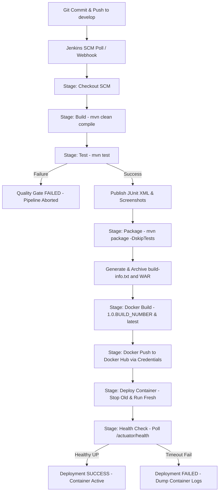

# 07 - Jenkins-Docker Continuous Deployment Pipeline

**Project:** Telecom Tower Maintenance Portal  
**Artifact:** CI/CD Containerization & Continuous Deployment Guide  
**Jenkins Pipeline:** `tower-portal-pipeline`  
**Docker Hub Repository:** `vedanti17/telecom-tower-portal`

---

## 1. End-to-End CD Workflow Architecture

The continuous delivery pipeline automates the complete journey from source code commit on GitHub to a running, health-verified container in local deployment environments.



---

## 2. Pipeline Stages Explained

| Stage | Command / Logic | Purpose & DevOps Rationale |
|---|---|---|
| **Checkout** | `checkout scm` | Clones the latest commit from branch `develop` onto the Jenkins workspace. |
| **Build** | `mvn clean compile` | Validates Java syntax, downloads Maven dependencies, and compiles production classes under Release 17 byte-code. |
| **Test** | `mvn test` | Executes the complete test suite (21 unit, integration, and headless Selenium E2E tests). Operates as a strict **Quality Gate**: if any test fails, Jenkins terminates the pipeline immediately, protecting downstream artifacts. |
| **Package** | `mvn package -DskipTests` | Packages the Spring Boot executable WAR archive into `target/`. Generates `build-info.txt` capturing metadata (`IMAGE_NAME`, `IMAGE_TAG`, `BUILD_NUMBER`, `ENVIRONMENT`, `HOST_PORT`) and archives both. |
| **Docker Build** | `docker build -t %IMAGE_NAME%:%IMAGE_TAG% -t %IMAGE_NAME%:latest .` | Builds the OCI container image using `Dockerfile` (Eclipse Temurin 21 JRE, non-root user `appuser`). Dual-tags the image with the immutable build number and mutable `latest`. |
| **Docker Push** | `withCredentials(...) { docker push ... }` | Authenticates securely to Docker Hub using standard input (`--password-stdin`) without leaking tokens in logs, pushes both version tags to `vedanti17/telecom-tower-portal`, and executes `docker logout`. |
| **Deploy Container** | `docker stop` & `docker run` | Inspects and records the previously running container image in `previous-image.txt` for audit and rollback. Gracefully stops and removes the old container, then launches the new version with `--restart unless-stopped`. |
| **Health Check** | Batch polling loop with `curl.exe` | Queries `http://localhost:%HOST_PORT%/actuator/health` up to 10 times (3s intervals). Confirms application readiness (`"status":"UP"`) before declaring deployment success. If unresponsive, dumps container logs and fails the pipeline. |
| **Deploy to Tomcat** *(Optional)* | Parameter `DEPLOY_TO_TOMCAT=true` | Preserves Task 8 legacy capability by copying the WAR directly to `%TOMCAT_HOME%\webapps\` if requested. |

---

## 3. Tagging Strategy: Immutable Versions & Mutable `latest`

1. **Versioned Tag (`1.0.${BUILD_NUMBER}`)**:
   - Represents an **immutable, reproducible release artifact**.
   - Every Jenkins execution increments `${BUILD_NUMBER}` (e.g., `1.0.1`, `1.0.2`, `1.0.3`), ensuring complete traceability back to the exact Git commit, surefire test reports, and Jenkins build console.
   - Enables instant zero-downtime rollback to known good builds simply by changing the target tag.
2. **Floating Tag (`latest`)**:
   - Points to the most recently built and successfully tested image on the default integration branch.
   - Simplifies developer pull operations (`docker pull vedanti17/telecom-tower-portal:latest`).

---

## 4. Secure Credential Management

- Jenkins stores the Docker Hub personal access token (PAT) securely in the Jenkins Credentials store under the credential ID:
  ```groovy
  credentialsId: 'dockerhub-creds'
  ```
- The pipeline injects the username and password dynamically via `withCredentials`:
  ```groovy
  withCredentials([usernamePassword(credentialsId: 'dockerhub-creds', usernameVariable: 'DH_USER', passwordVariable: 'DH_PASS')]) {
      bat 'echo %DH_PASS%| docker login -u %DH_USER% --password-stdin'
  }
  ```
- **Security Guarantees:**
  - Standard input piping (`--password-stdin`) prevents credentials from appearing in process listings (`ps`).
  - Notice the strict omission of spaces before the pipe (`%DH_PASS%|`) to prevent trailing newline/whitespace corruption in Windows batch.
  - Jenkins automatically masks secret values as `****` in the build console.
  - `docker logout` ensures credentials are wiped from the local Docker config cache immediately after pushing.

---

## 5. Rollback & Audit Mechanism

Before removing an active container, the `Deploy Container` stage executes:
```cmd
docker inspect --format="{{.Config.Image}}" %CONTAINER_NAME% > previous-image.txt 2>nul || echo None > previous-image.txt
```
If an operator needs to roll back to the previously deployed version, the previous image tag is preserved in `previous-image.txt` and logged in the Jenkins build console, enabling a single-command manual or automated rollback:
```powershell
docker stop tower-portal-dev
docker run -d --name tower-portal-dev -p 8084:8080 --restart unless-stopped <PREVIOUS_IMAGE_TAG>
```

---

## 6. Environment & Port Mapping Reference

| Environment | Parameter Value | Container Name | Host Port | Container Port | URL |
|---|---|---|---|---|---|
| **Development** | `dev` | `tower-portal-dev` | `8084` | `8080` | `http://localhost:8084` |
| **Testing** | `test` | `tower-portal-test` | `8083` | `8080` | `http://localhost:8083` |
| **Tomcat (Legacy)** | N/A | Host Service | `8080` | N/A | `http://localhost:8080/tower-portal-dev` |
| **Jenkins** | N/A | Windows Service | `8082` | N/A | `http://localhost:8082` |
