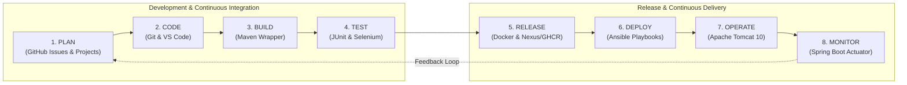
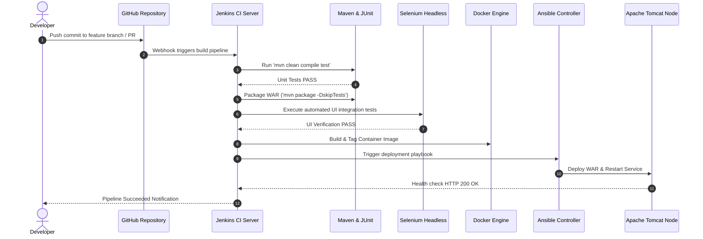

# DevOps Lifecycle & Toolchain Mapping

This document illustrates the end-to-end DevOps lifecycle for the **Telecom Tower Maintenance Portal**, mapping each phase from ideation to production observability against specific industry-standard tools.

---

## 1. DevOps Lifecycle Flowchart

---

## 2. Toolchain Mapping Matrix

| Lifecycle Phase | Tool | Role & Responsibility in Project |
|---|---|---|
| **1. Plan** | **GitHub Issues / Projects** | User stories, backlog grooming, bug tracking, sprint planning, and Kanban workflow. |
| **2. Code** | **Git / GitHub** | Feature-branch development (`feature/*`), code reviews via Pull Requests, and branch protection. |
| **3. Build** | **Apache Maven (`mvnw`)** | Automated dependency management, compilation, resource filtering, and WAR packaging. |
| **4. Test** | **JUnit 5 / Selenium** | Unit testing business rules/state transitions; automated browser testing with stable element IDs. |
| **5. Release** | **Docker / GitHub Packages** | Multi-stage Docker containerization of the WAR file and semantic release tagging (`v1.0.0`). |
| **6. Deploy** | **Ansible** | Automated configuration management, idempotently provisioning Tomcat servers and deploying WAR artifacts. |
| **7. Operate** | **Apache Tomcat** | Robust Java Servlet runtime container executing the Spring Boot WAR application. |
| **8. Monitor** | **Spring Boot Actuator** | Health check endpoints (`/actuator/health`), application metrics, and uptime surveillance. |

---

## 3. Automation Orchestration: Jenkins CI/CD Pipeline

